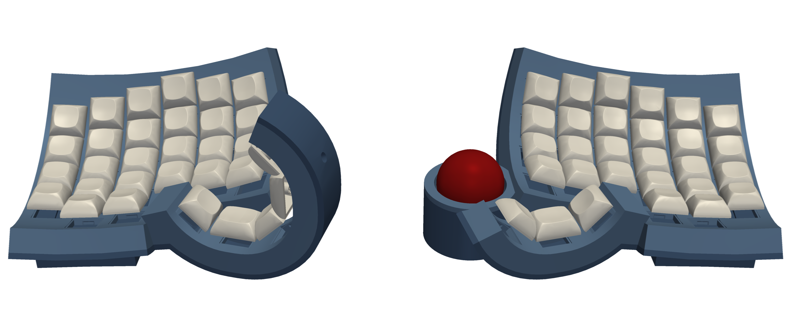

# The Azura Keyboard

The Azura is a parameterized, split-hand, concave, columnar, ergonomic keyboard: a 3D model of its case, generated in
[Python][] with [build123d][].



Azura builds on and is inspired by the [Dactyl Lynx][] and the wonderful work of its author, David H. Bronke, itself a
rewrite of [the original Dactyl][]. Without them, this keyboard wouldn't exist.

[Dactyl Lynx]: https://github.com/whitelynx/dactyl-lynx-keyboard
[the original Dactyl]: https://github.com/adereth/dactyl-keyboard
[Python]: https://www.python.org/
[build123d]: https://github.com/gumyr/build123d


## The model

* Each half has a finger case whose keys lie on a torus, so the columns and rows both curve around the fingers, and a
  thumb case with its keys on an arc: five thumb keys on the left half, three and a trackball on the right.
* The trackball sits in a cup next to the right thumb keys, with an optical sensor (a [PMW3610 breakout board][])
  below it.
* Every key switch sits on its own small PCB under the key plate.
* The case is printed in two parts per half, a top (key plates and walls) and a bottom (floors and skirt), screwed
  together.

[PMW3610 breakout board]: https://github.com/siderakb/pmw3610-pcb


## Generating the model

### Prerequisites

* [Python][] version 3.12–3.14
* [uv](https://docs.astral.sh/uv/)

### Installing dependencies

```bash
uv sync
```

### Generating

```bash
uv run python -m azura_keyboard
```

This writes STEP files for the case's top and bottom and the combined model of each half to `things/`, plus
models with Cherry MX switches and PCBs in place for checking collisions (not meant for printing). The repository
doesn't contain them: generate them yourself.
The Cherry MX model in `resources/SW_Cherry_MX_Plate.stp` is from [kiswitch](https://github.com/kiswitch/kiswitch)
(MIT / CC-BY-SA 4.0); the DSA keycaps come from the [dsa-keycap](https://github.com/anhthang/dsa-keycap) submodule
(MIT) and the trackball sensor's board from the [pmw3610-pcb](https://github.com/siderakb/pmw3610-pcb)
submodule (CERN-OHL-P v2), so clone with `--recursive` or run `git submodule update --init`.


## Customizing

When customizing your keyboard, you might want to look at API docs for the classes in `azura_keyboard`. You can use `pdoc` for this:
```bash
pdoc -t templates azura_keyboard
```


## License

Copyright © 2015-2024 Matthew Adereth and David H. Bronke  
Copyright © 2026 Hannes Ellinger

The source code for generating the models (everything excluding the generated `things/` and the [resources/](resources/) directories) is distributed under the [GNU AFFERO GENERAL PUBLIC LICENSE Version 3](LICENSE).  The generated models and PCB designs are distributed under the [Creative Commons Attribution-ShareAlike License Version 4.0](LICENSE-models).
